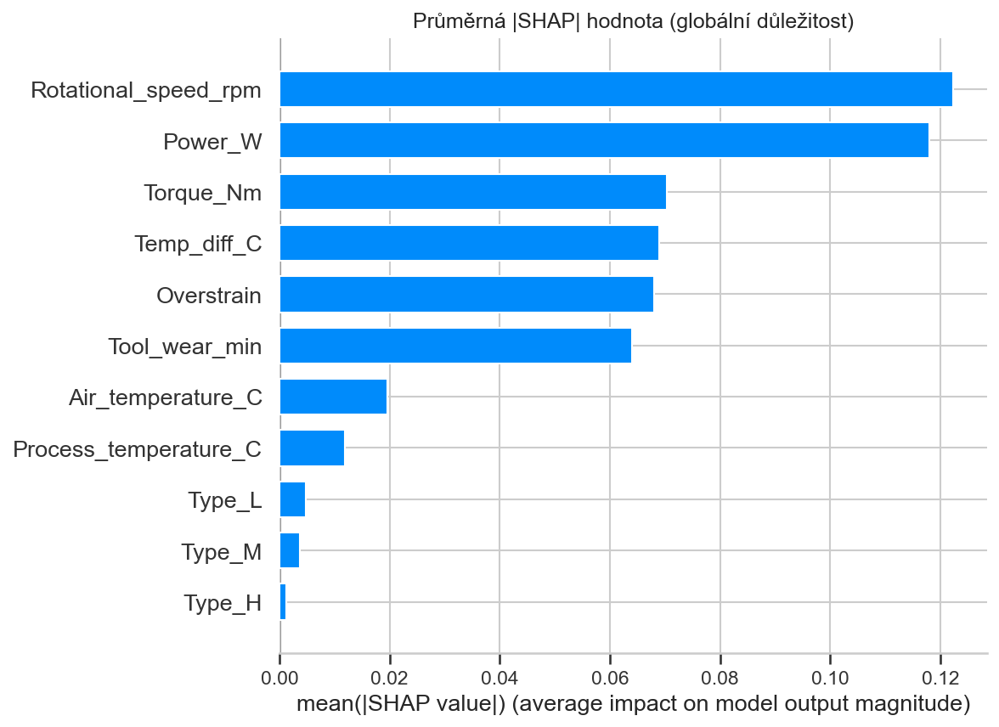
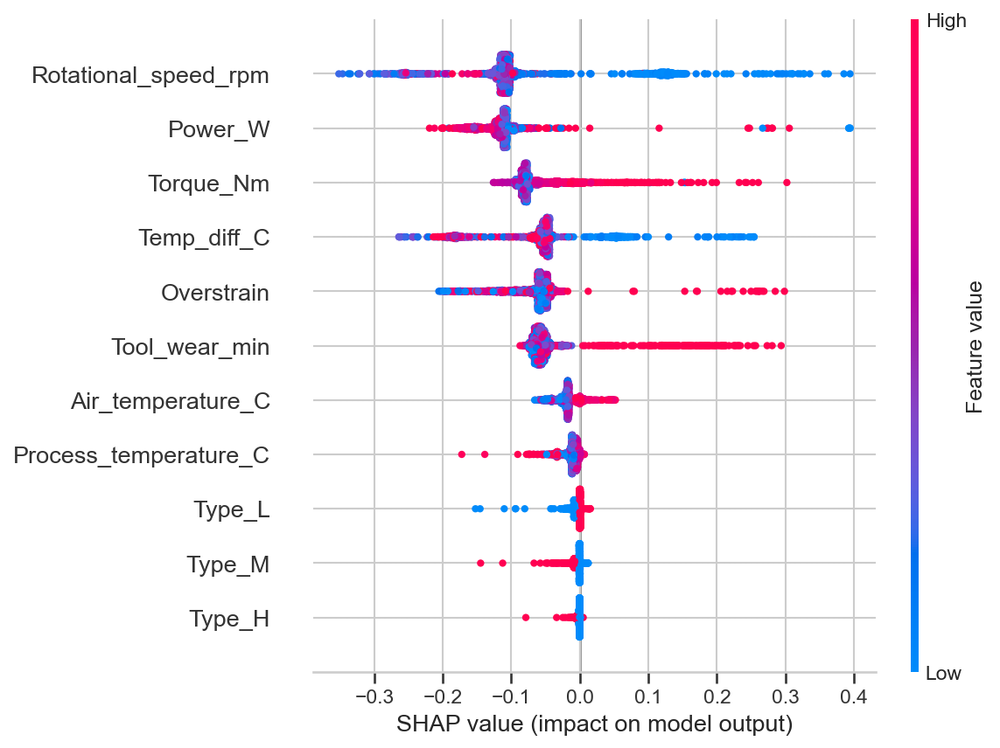
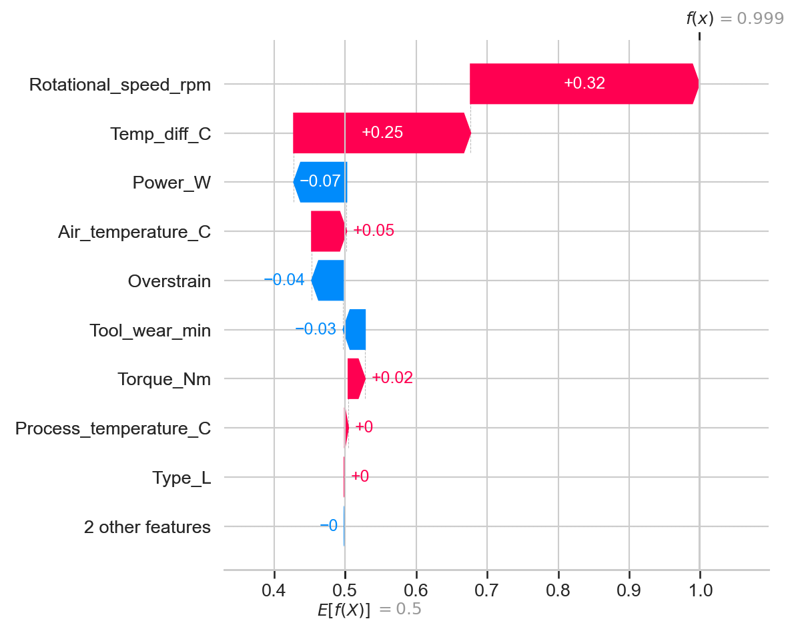

# Predictive Maintenance

Predikce poruchy stroje na výrobní lince ze senzorových dat (teplota, otáčky, točivý moment, opotřebení nástroje).

## Dataset

`data/ai4i2020.csv` — [AI4I 2020 Predictive Maintenance Dataset](https://archive.ics.uci.edu/dataset/601/ai4i+2020+predictive+maintenance+dataset) z UCI Machine Learning Repository (CC BY 4.0). Syntetický, ale realisticky namodelovaný dataset napodobující provoz výrobní linky — 10 000 záznamů, 14 sloupců.

| Sloupec | Popis |
|---|---|
| UDI / Product ID | identifikátory záznamu, bez prediktivní hodnoty |
| Type | kategorie kvality produktu (L = low, M = medium, H = high) |
| Air temperature [K] | teplota vzduchu |
| Process temperature [K] | teplota procesu |
| Rotational speed [rpm] | otáčky |
| Torque [Nm] | točivý moment |
| Tool wear [min] | opotřebení nástroje |
| Machine failure | cílová proměnná — 0/1, došlo k poruše |
| TWF, HDF, PWF, OSF, RNF | příznaky jednotlivých typů poruchy (viz níže) — **nejsou** vstupní feature, viz sekce Data leakage |

## Cíl

Binární klasifikace: predikovat `Machine failure` z provozních senzorů, dřív než k poruše skutečně dojde.

## Data leakage — proč jsou TWF/HDF/PWF/OSF/RNF vyřazené

`Machine failure` je definovaná jako logický OR pěti dílčích příznaků poruchy (opotřebení nástroje, nedostatečný odvod tepla, výkonová porucha, přetížení, náhodná porucha). Ponechat je jako vstupní features by znamenalo naučit model triviální kopírování cílové proměnné — v reálném provozu tyto příznaky navíc nejsou dopředu známé (jsou to spíš *popis* poruchy než její *předzvěst*). Proto zůstávají mimo trénovací data.

## Feature engineering

Tři odvozené veličiny, každá motivovaná přímo definicí konkrétního typu poruchy (viz výše):

| Sloupec | Výpočet | Proč |
|---|---|---|
| `Power [W]` | `Torque × Rotational speed × 2π/60` | přibližný mechanický výkon — souvisí s Power Failure (mimo bezpečné pásmo 3500–9000 W) |
| `Temp_diff [C]` | `Process temperature − Air temperature` | rozdíl teplot přímo souvisí s Heat Dissipation Failure (< 8,6 °C) |
| `Overstrain` | `Tool wear × Torque` | mechanické namáhání — souvisí s Overstrain Failure (práh se liší podle `Type`) |

Teploty jsou přepočtené z Kelvinů na °C (kosmetická úprava, na model nemá vliv). `Type` (L/M/H) je nominální kategorie → one-hot encoding (`dtype=int`).

## Škálování

Stromové modely (Random Forest, LightGBM) škálování nepotřebují — dělí podle prahů bez ohledu na měřítko. Pro Logistic Regression:
- `Rotational speed` má pravostranně zešikmené rozložení s odlehlými hodnotami → `RobustScaler` (medián/IQR)
- ostatní číselné sloupce jsou blízko symetrické → `StandardScaler`

Oba scalery se fitují **jen na trénovacích datech** (`ColumnTransformer` uvnitř train/test splitu), aby testovací sada zůstala nezasažená.

## Modely a výsledky (80/20 train/test split, stratifikovaně)

Dataset je silně nevyvážený (poruchy jen 3,4 % záznamů) → modely trénované s `class_weight="balanced"` / `scale_pos_weight`, vyhodnocení přes ROC-AUC i PR-AUC (na nevyváženém datasetu vypovídá víc než ROC-AUC samotné).

| Model | ROC-AUC | PR-AUC | Precision@0.5 | Recall@0.5 |
|---|---|---|---|---|
| Logistic Regression | 0,939 | 0,430 | — | — |
| Random Forest (výchozí parametry) | 0,985 | 0,877 | 0,96 | 0,75 |
| LightGBM (výchozí parametry) | 0,976 | 0,875 | — | — |
| LightGBM (vyladěný) | 0,986 | 0,892 | 0,60 | 0,88 |
| **Random Forest (vyladěný, finální)** | 0,973 | **0,890** | **0,97** | **0,82** |

### Ladění hyperparametrů

Pro fér srovnání jsme doladili oba stromové modely — `RandomizedSearchCV` (40 kombinací, 5-fold stratifikovaná CV, optimalizováno přímo na PR-AUC):
- **Random Forest:** `n_estimators`, `max_depth`, `min_samples_split`, `min_samples_leaf`, `max_features`, `class_weight`. Nejlepší parametry: `n_estimators=800, max_depth=16, min_samples_split=2, min_samples_leaf=2, max_features=0.7, class_weight="balanced"`.
- **LightGBM:** `n_estimators`, `num_leaves`, `max_depth`, `learning_rate`, `min_child_samples`, `subsample`, `colsample_bytree`, `reg_alpha`, `reg_lambda`, `scale_pos_weight`.

Vyladěný Random Forest při prahu 0.5 dosahuje precision 0,97 / recall 0,82 — oproti nevyladěné verzi (precision 0,96 / recall 0,75) zachytí o 7 poruch víc při zachování vysoké přesnosti.

### Proč finální model NENÍ vybraný čistě podle nejvyššího PR-AUC

Vyladěné LightGBM má PR-AUC nepatrně vyšší než vyladěný Random Forest (0,892 vs 0,890 — rozdíl v řádu šumu), ale chování při běžném rozhodovacím prahu 0.5 je diametrálně jiné: hledání hyperparametrů u LightGBM zvolilo vysoký `scale_pos_weight`, takže model při tomto prahu chrlí mnohem víc pozitivních predikcí — recall vzroste na 0,88, ale precision se propadne na 0,60 (z 68 poruch v testu by bylo cca **40 falešných poplachů** místo ~2 u Random Forestu). V reálném provozu by tolik falešných poplachů vedlo k tomu, že obsluha linky přestane modelu věřit ("alert fatigue"). Proto je finální model zvolený **ručně** — Random Forest (vyladěný) — s vědomím, že LightGBM by při jinak zvoleném prahu mohl dosáhnout srovnatelné nebo lepší rovnováhy.

**Poznámka k prahu:** v reálném provozu je zmeškaná porucha (false negative) dražší než falešný poplach — odstávka linky > zbytečná kontrola. Práh 0.5 je proto jen výchozí bod; v nasazení by se ladil podle skutečného poměru nákladů.

## Explainable AI (SHAP)

`TreeExplainer` nad finálním modelem (vyladěný Random Forest).

### Globální důležitost (mean |SHAP|)

Pořadí důležitosti: `Rotational speed` ≈ `Power` > `Torque` ≈ `Temp_diff` ≈ **`Overstrain`** > `Tool wear` > teploty > `Type`. `Overstrain` zůstává mezi top-5 featurami i po ladění — potvrzuje, že mechanické namáhání (opotřebení × moment) je jeden z hlavních signálů poruchy.

### Beeswarm plot

Nejsilnější prediktory odpovídají fyzice definovaných poruch: **otáčky a výkon** (Power Failure), **točivý moment**, **rozdíl teplot** (Heat Dissipation Failure) a **`Overstrain`** (Overstrain Failure — vysoké opotřebení × vysoký moment). Model se tedy opírá o smysluplné signály, ne o náhodné korelace.

### Lokální vysvětlení (waterfall)

Rozklad predikce pro záznam s nejvyšší predikovanou pravděpodobností poruchy:

## Další kroky

- Ladění rozhodovacího prahu podle reálného poměru nákladů (odstávka vs. falešný poplach) — případně i pro LightGBM (tuned), který by při jiném prahu mohl konkurovat Random Forestu
- Retrénink na proudu nových dat / drift monitoring
- Jednoduchý dashboard pro obsluhu linky s real-time rizikovým skóre
